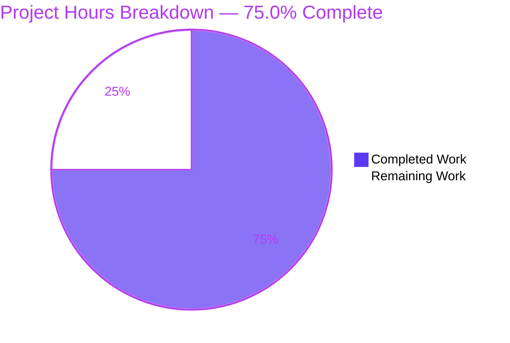
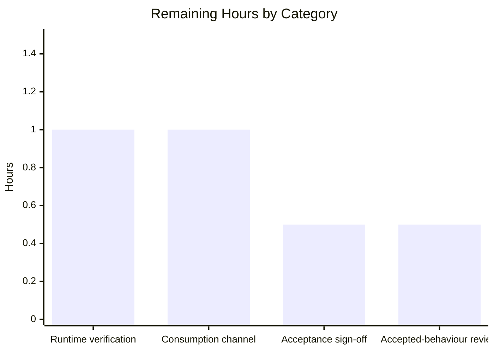

# 1. Executive Summary

## 1.1 Project Overview

This project delivers the smallest runnable artefact that satisfies its request: a zero-dependency Node.js console script that prints the exact string `Welcome to Blitzy` to standard output, with a three-line README stating what it prints and how to run it. It serves developers wanting a quick smoke check and the stakeholder who asked for the greeting. The scope is fully bounded: two files at the repository root, one unconditional statement, no manifest, no lockfile, no dependency, no build step, no configuration, no test suite and no user interface. Success is the exact output rather than a feature set.

## 1.2 Completion Status

Completion measures only the scoped work plus its path-to-production activities.



| Metric | Hours |
|--------|-------|
| Total Hours | 12.0 |
| Completed Hours (AI + Manual) | 9.0 |
| Remaining Hours | 3.0 |

**9.0 completed hours ÷ 12.0 total hours = 75.0% complete.** All completed hours are autonomous; no manual engineering time has been spent. Of the 16 requirements in scope, 15 are complete and 1 is partial — the runtime recommendation, whose wording is verified while the recommended line itself has not been exercised.

## 1.3 Key Accomplishments

- The exact greeting: 18 bytes, `Welcome to Blitzy` plus one newline, verbatim (`index.js:2`).
- One-command operation from a clean checkout, with no install, build or configuration step (`README.md:3`).
- A repository confined to exactly two files, one code and one documentation, both at the root.
- Zero dependencies: no manifest, no lockfile, nothing to install or keep in step.
- Deterministic output across 200 sequential runs, 50-way concurrency, 16 argument and 11 environment shapes.
- Silence beyond the greeting: empty standard error, no help text, no error path, no argument parsing.
- A byte-exact acceptance gate, documented and passing: `node index.js | diff - <(printf 'Welcome to Blitzy\n')` reports `GATE_PASS`.
- A run instruction that works verbatim, in a three-line README under its five-line cap.

## 1.4 Critical Unresolved Issues

**4 of the 16 requirements in scope carry an open item; none blocks release.**

| Issue | Impact | Owner | ETA |
|-------|--------|-------|-----|
| The recommended Node.js 24 LTS line has never been exercised | The README's recommendation is unconfirmed on the line it names | Release engineer | 0.5 day |
| No consumption channel is defined for a manifest-free script | Consumers have no agreed way to obtain the entry point | Maintainer | 0.5 day |
| Acceptance sign-off against the original request is outstanding | Release waits on the stakeholder's confirmation of the content and the two-file boundary | Requesting stakeholder | 0.5 day |
| An unwritable or closed standard output is silent (exit 0, empty stderr) | A consumer checking only the exit status could read a lost write as success | Product owner | 0.5 day |

## 1.5 Access Issues

| System/Resource | Type of Access | Issue Description | Resolution Status | Owner |
|-----------------|----------------|-------------------|-------------------|-------|
| Node.js 24 LTS runtime | Runtime installation | The recommended line is not installed on this host and installing a second Node.js release is outside the environment's constraints; verification ran on Node.js v22.23.3 | Open | Release engineer |

No other access issues identified: no credential, third-party API or database is needed.

## 1.6 Recommended Next Steps

1. **[High]** Run the byte-exact gate and confirm the greeting, the two-file tree and the README wording.
2. **[High]** Run the program on Node.js 24 LTS before announcing that recommendation.
3. **[Medium]** Decide and record how consumers obtain a script with no manifest or packaging.
4. **[Medium]** Edit `index.js:2` and `README.md:3` together for any message change, then re-run the gate.
5. **[Low]** Decide whether the designed silence on an unwritable standard output is acceptable.

# 2. Project Hours Breakdown

## 2.1 Completed Work Detail

| Component | Hours | Description |
|-----------|-------|-------------|
| Console entry point — the greeting on standard output | 1.5 | `index.js` — the single unconditional statement that writes the fixed 17-character greeting, in the required two-line form with one one-line JSDoc summary, verified byte-for-byte across every output channel. |
| One-command run from a clean checkout | 1.5 | `index.js` at the repository root, executable as `node index.js` with no install, build or configuration step, verified from a clean two-file copy, a source-archive extract, the repository root, relative and absolute path forms, stripped and HOME-less environments and a path containing a space and non-ASCII characters. |
| Repository README usage note | 1.0 | `README.md` — the three-line note carrying the run instruction and the runtime recommendation within the five-line cap, with every claim resolved against the code and the runtime documentation it cites. |
| Zero-dependency delivery | 1.0 | The absence of any manifest, lockfile and dependency, established and then confirmed at runtime: the program runs with nothing installed and no package manager invoked. |
| Deterministic single-output execution | 1.5 | Invariance of the output across 200 sequential runs, 50-way and 20-way concurrency, 16 argument shapes, 7 stdin conditions and 11 environment shapes, together with the measurement of exactly one 18-byte write to standard output. |
| Silence and no added behaviour | 1.0 | Confirmation that nothing beyond the single greeting is emitted or read: empty standard error under every flag, argument, stdin and environment variant, with no help text, error path, environment read or fallback. |
| Content contract, comment form and repository boundary | 1.5 | Byte-exact comparison of both delivered files against the agreed content, the line budgets, the single one-line comment, the two-file tree and the inventory confirming every excluded artefact is absent. |
| **Total** | **9.0** | |

Section 2.1 plus Section 2.2 equals the 12.0 Total Project Hours in Section 1.2.

## 2.2 Remaining Work Detail

| Category | Hours | Priority |
|----------|-------|----------|
| Runtime verification on the recommended Node.js line — confirm the greeting on Node.js 24 LTS, the line the README names | 1.0 | Medium |
| Consumption channel for the manifest-free entry point — decide and record how a consumer obtains and runs a script that ships with no manifest or packaging | 1.0 | Medium |
| Human acceptance sign-off — confirm the exact file contents, the two-file boundary and the README wording against the original request | 0.5 | High |
| Accepted-behaviour review — decide whether the designed silence on an unwritable standard output is acceptable for the intended consumers, or raise a change request | 0.5 | Low |
| **Total** | **3.0** | |

No item here asks for work the request forbids: none of these adds a manifest, a dependency, a test artefact, a configuration file or any hardening to the program.

## 2.3 Estimation Basis

Completed hours were sized from the behaviour delivered and the verification actually exercised over it, since the artefacts themselves are five lines in total and their cost lies in the exactness of the content and the breadth of the runtime confirmation. Remaining hours were sized from the four open items in Section 1.4, using straightforward per-task estimates: a runtime re-verification on a second Node.js release (1.0h), a release decision and its written record (1.0h), a stakeholder review pass (0.5h) and a product decision on one accepted behaviour (0.5h).

Confidence is **high** on the completed figure: both files are byte-exact to the agreed content and the acceptance checks were run first-hand rather than inferred. Confidence is **medium** on the remaining figure, because the tail consists of human decisions whose scope depends on the release channel ultimately chosen.

**Completion = Completed Hours ÷ (Completed Hours + Remaining Hours) × 100 = 9.0 ÷ 12.0 × 100 = 75.0%.**

# 3. Test Results

The project ships with no test framework, and none may be added: the request forbids a test suite, a lockfile, a dependency and any manifest, so the acceptance criterion is the exact content of the two files and their behaviour when run. What follows is therefore the acceptance battery that was executed against the delivered revision — a syntax gate, the documented byte-exact gate, and 133 checks grouped by the area of behaviour each one exercises. Every count below was observed in a run against the delivered files.

| Area / Category | Framework | Tests | Passed | Failed | Coverage | What This Proves |
|-----------------|-----------|-------|--------|--------|----------|------------------|
| Greeting fidelity | Node.js CLI, byte comparison | 22 | 22 | 0 | Not measured | Standard output is exactly `Welcome to Blitzy` plus one newline — 18 bytes, verbatim — and arrives complete through a pipe, a regular file, `/dev/null`, a FIFO, a terminal, an append sink, a partial consumer and a non-shell parent. |
| Clean-checkout invocation | Node.js CLI | 23 | 23 | 0 | Not measured | One command runs the program from a fresh checkout with no install, build or configuration step, and nothing is needed beyond the runtime. |
| Tree confinement and single code file | Node.js CLI, Node permission model | 10 | 10 | 0 | Not measured | Only the entry point executes; nothing is created, written or read elsewhere, and the tree is byte-identical after every run. |
| Determinism | Node.js CLI | 40 | 40 | 0 | Not measured | Output is identical across 200 sequential runs, 50-way and 20-way concurrency, 16 argument shapes, 7 stdin conditions and 11 environment shapes, and exactly one 18-byte write reaches standard output. |
| Silence and no added behaviour | Node.js CLI | 12 | 12 | 0 | Not measured | Nothing beyond the single greeting is emitted: empty standard error, no help or usage text, no error path, no environment read and no argument parsing. |
| Dependency freedom | Node.js CLI, npm | 5 | 5 | 0 | Not measured | No manifest, lockfile or dependency is required to run, and the run is the runtime binary alone. |
| Content contract | `diff`, `wc`, `grep`, `file` | 16 | 16 | 0 | Not measured | Both files match the agreed content byte-for-byte, within their line budgets, with one single-line comment and no forbidden construct. |
| Forbidden artefact inventory | `find`, `git ls-files` | 5 | 5 | 0 | Not measured | Every excluded artefact and construct is absent, and the tree holds exactly the two agreed files. |
| **Total** | | **133** | **133** | **0** | | |

**Gates.** Two gates were run directly and both pass: `node --check index.js` exits 0 with no diagnostics, and the byte-exact package gate `node index.js | diff - <(printf 'Welcome to Blitzy\n')` produces no difference and reports `GATE_PASS`. The greeting digest on a single run matches the reference exactly.

**Coverage is not measured anywhere in this project.** No instrumentation, coverage or test-framework tooling exists in the tree, and adding it is forbidden by the request, so no coverage percentage can be stated. The byte-exact gate is the durable acceptance check and the only regression safety net the repository carries.

### Not Covered

These were delivered but are not exercised by any test, and a human should confirm them before release:

- **The recommended runtime line.** The README names Node.js 24 LTS as a recommendation, and the greeting was exercised only on the Node.js v22 line available here. Nothing in the program is version-sensitive — it is a single call to a long-standing built-in — but the recommendation itself is unconfirmed. Confirm the 18-byte output, empty standard error and exit status 0 on the recommended release before announcing it.
- **Any release older than Node.js v22.** No lower bound was declared or exercised, so the oldest supported line is unverified.
- **Direct execution of the file.** `./index.js` is not a supported invocation: the entry point is a non-executable regular file with no shebang line, which the request requires. The documented `node index.js` form is the one that works; a human should ensure nothing downstream assumes otherwise.
- **An unusual standard-output sink.** A datagram-socket standard output delivers no bytes; a one-line control program behaves identically, so this is runtime behaviour rather than a property of the delivered code, but it is unverified for the delivered program.
- **The recommended runtime's interaction with the greeting under a hostile sink.** A full or closed standard output exits 0 with empty standard error by design; only that outcome was observed, and whether it is acceptable is a decision rather than a test.

# 4. Runtime Validation & UI Verification

The delivered program has no user interface, no HTTP surface, no network call and no component boundary, so there is no screen to drive, no form to fill and no endpoint to call. Its entire runtime surface is one command, two output streams, an exit status and the immutability of the tree; each of those was exercised. The statuses below describe what was actually run.

- ✅ **Start-up and invocation** — `node index.js` from the repository root, from a clean two-file copy, from a source-archive extract with no `.git`, by relative and absolute path, under `sh -c`, via a symlinked entry point and in a stripped environment: exit status 0 every time.
- ✅ **Greeting output** — 18 bytes, `Welcome to Blitzy` followed by one newline, byte-identical to the reference through a pipe, a regular file, `/dev/null`, a FIFO, a terminal, an append-mode sink, a slow consumer and a consumer that closes after one byte.
- ✅ **Determinism under repetition and concurrency** — 200 sequential runs and 50-way and 20-way parallel runs each produced a single distinct line with no partial or interleaved output.
- ✅ **Argument, stdin and environment invariance** — flags including `--help`, `-h` and `--version`, a 10,000-character argument, traversal, script-injection and SQL-injection payloads, empty, closed, piped and never-closing stdin, and eleven environment shapes including stripped, hostile and colour-forcing values: byte-identical output, empty standard error, exit status 0.
- ✅ **Runtime confinement** — the repository tree, a clean copy and an empty working directory are unchanged after every run, no file or socket is opened, no process outlives the invocation, and the program runs under Node's permission model with the file-system denial control confirmed to fire.
- ✅ **No external integrations** — the program opens no socket, reads no file, holds no credential and reads no environment variable, so there is no integration to exercise and none was attempted.
- ⚠ **Recommended runtime** — the greeting was exercised on Node.js v22.23.3 only; the Node.js 24 LTS line the README recommends was never run.
- ⚠ **Unwritable or closed standard output** — the program exits 0 with empty standard error, so the failure is not surfaced; this is the designed outcome of the request's no-error-handling constraint.
- ❌ **Failing flows** — none: every flow exercised reached its expected outcome.

**Never exercised at runtime:** the recommended Node.js 24 LTS line and any release below v22; direct execution of the file, which is not a supported invocation because the entry point carries no shebang line and is not executable; and an unusual datagram-socket standard output. No browser, HTTP, database or user-interface validation was performed or applies, because the deliverable has no surface of that kind.

# 5. Compliance & Quality Review

## 5.1 Compliance Matrix

Each deliverable is shown in the state it stands in now, against the quality and compliance expectations this change was held to: the request's own constraints, the content and boundary the change was planned to deliver, and the standard expectations of a zero-dependency Node.js console script.

| # | Deliverable | Status | Evidence |
|---|-------------|--------|----------|
| 1 | Greeting written to standard output exactly, unformatted (FR1) | ✅ Complete | `index.js:2`; 18 bytes, digest-matched, through nine sink kinds |
| 2 | Runnable from a clean checkout with one command, no install, build or configuration (FR2) | ✅ Complete | `README.md:3`; 23 invocation checks from clean copies, archives and stripped environments |
| 3 | Run instruction carried in the README within the stated line cap (FR3) | ✅ Complete | `README.md` 3 lines against a cap of 5; the instruction works verbatim |
| 4 | Implementation confined to one code file at the root (FR4) | ✅ Complete | `index.js` is the tree's only code file; the command needs no path prefix |
| 5 | Two-line lowest-token form, semicolon, double-quoted literal, one trailing newline (NFR1) | ✅ Complete | 2 lines / 88 bytes, byte-exact to the agreed content |
| 6 | Zero runtime and development dependencies (NFR2) | ✅ Complete | No manifest, lockfile or dependency; the run needs nothing installed |
| 7 | Deterministic single-path execution with one stdout write (NFR3) | ✅ Complete | 40 invariance checks; exactly one 18-byte write measured |
| 8 | Nothing beyond the request — no error handling, logging, configuration or hardening (NFR4) | ✅ Complete | Zero forbidden constructs; empty standard error in every run |
| 9 | Content contract and comment form | ✅ Complete | Both files byte-exact; one single-line summary comment; no tag block |
| 10 | Required absences — every excluded artefact and construct is missing | ✅ Complete | 36 probed paths absent; no test artefact, manifest or tooling |
| 11 | Runtime recommendation named as a recommendation, with no version floor | ⚠️ Partial (80%) | `README.md:3` wording verified and no floor declared; the recommended line was never exercised |
| 12 | Two-file repository boundary and implementation order | ✅ Complete | Tracked and on-disk sets both exactly two files; the entry point landed before the documentation |

## 5.2 AAP & Rule Divergences and Gaps

Seven departures were identified. Each is stated in terms of the delivered codebase, with the evidence a reader can open. Four are sanctioned — the request's own constraints require them — one is a labelling divergence with no effect on the delivered bytes, one is constrained by the environment, and one is a designed behaviour accepted rather than changed.

| # | What the AAP/Rule Required | What Was Delivered Instead | Why It Diverged | Impact | Remediation |
|---|----------------------------|----------------------------|-----------------|--------|-------------|
| 1 | Both files described as creations in a workspace holding no files, with nothing updated or deleted | `README.md` already existed at the base commit as a two-line placeholder and was rewritten in place at the same path (`21dc284`), so it arrives as a modification | The plan's premise about the starting state did not hold; the file was already tracked, and its delivered bytes are exactly the agreed content | None to the delivered content; a reader reverting or re-documenting the change set must not treat the file as newly created | None required — read `README.md` as a rewrite of the placeholder commit `e070a69` introduced |
| 2 | A lint step, a Markdown linter and a test framework as the process expectations for a delivered change | Validation used `node --check index.js` for syntax, structural checks for the Markdown and an out-of-tree harness for behaviour; no test artefact was committed | **Sanctioned** — the request forbids a test suite, a lockfile, any dependency and any manifest, so no such tooling could be added | The repository carries no automated regression guard; the byte-exact gate is the only check | Keep the byte-exact gate as the release precondition; revisit only if the no-tooling constraint is lifted |
| 3 | Error handling throughout, appropriate logging points and a test coverage target | No error handling, no logging and no coverage target | **Sanctioned** — the request forbids all three, and the plan resolves the template conflict in the request's favour, the plan outranking the template | None on correctness: the delivered program is exactly what was asked for | None — the absences are the requirement |
| 4 | Node.js 24 LTS named in the README as the recommended runtime | Delivered as specified, and verified on Node.js v22.23.3 only | The recommended line is not installed on this host and a second Node.js release may not be installed; no version floor was ever set | The recommendation is unconfirmed on the line it names; nothing in the program is version-sensitive | Run the program on Node.js 24 LTS and record the result (1.0h) |
| 5 | No tooling and no manifest, so no ignore file may be added | Two empty, untracked artefact directories remain in the working tree with no `.gitignore` covering them | **Sanctioned** — the run instructions state these directories hold browser-tooling output that must never be committed and forbid adding a `.gitignore` | None: git cannot commit an empty directory and the working tree reports clean | None required |
| 6 | No manifest, with `node index.js` as the run command | `npm start` fails with `ENOENT` and exit status 254 | **Sanctioned** — a manifest is forbidden by the request, so npm has no script to run | A consumer who expects `npm start` sees a failure | None required — use `node index.js`, as the README states |
| 7 | Error handling, exit-code handling, logging and hardening all forbidden | A full or closed standard output exits 0 with empty standard error | The prohibition is the requirement itself, so nothing can surface a failed write | Low: a consumer checking only the exit status could read a lost write as success | Decide whether this is acceptable for the intended consumers; if not, raise a change request against the constraint (0.5h) |

**Divergence 1 — the README is a rewrite, not a creation.** The plan describes both files as creations in a repository holding no files, and states that nothing is updated. In fact `README.md` was already tracked: commit `e070a69` added it with the two-line placeholder `# 5th-project-511d0ab5` / `Created by Blitzy`, and commit `21dc284` replaced those lines with the three agreed ones, so the change arrives as `M README.md`. The cause is that the plan's premise about the starting state did not hold. The delivered bytes are byte-identical to the agreed content, so nothing is missing; a reader reverting or re-documenting this change set should treat `README.md` as a rewrite of the placeholder, not as a file the change created.

**Divergence 2 — validation substituted permitted checks for the expected tooling.** The standard process for a delivered change expects a lint step, a Markdown linter and a test framework. None was used, because the request forbids a test suite, a lockfile, any dependency and any manifest, so adding one would itself have been the violation. Syntax was gated with `node --check index.js`, which parses without executing; the Markdown was checked structurally for line count, encoding and balanced delimiters; and behaviour was exercised from a harness outside the checkout, with nothing test-related committed. Its consequence is what a reviewer should weigh: no automated regression guard exists, so the byte-exact gate is the only check, and it belongs in the release procedure.

**Divergence 3 — the template's error-handling, logging and coverage expectations are not met.** A generic engineering template for a delivered change expects error handling throughout, appropriate logging points and a test coverage target. `index.js` carries none of the three: it is one unconditional statement, with no `try`/`catch`, no logging call and no coverage bar. This is sanctioned rather than accidental — the request forbids error handling, logging, a test suite and any verification or coverage artefact, and the plan records that resolution in the request's favour. Since a plan outranks the template, the departures are required and the delivered program is exactly what was asked for. Nothing needs closing: the absences are the requirement.

**Divergence 4 — the recommended runtime line is unverified.** `README.md:3` tells a reader that Node.js 24 LTS is recommended. The program was delivered exactly as agreed and verified on Node.js v22.23.3, the line this host provides; the recommended line was never run, because no second Node.js release may be installed here. No version floor was ever set — no `engines` field, version matrix or version file exists — so nothing in the delivered behaviour is version-sensitive. Still, the recommendation names a line that has not been exercised. The remedy belongs to release: run the program on Node.js 24 LTS, confirm the 18-byte greeting with empty standard error and exit status 0, and only then announce the recommendation.

**Divergence 5 — two empty artefact directories sit untracked, with no ignore file.** The working tree contains `blitzy/screenshots/` and `blitzy/screen_recordings/`. They hold no files, they are not part of the delivered change set, and no `.gitignore` covers them. That is sanctioned: the run instructions state these directories hold browser-tooling output that must never be committed and explicitly forbid adding a `.gitignore` for them. The practical effect is nil, because git cannot track an empty directory and `git status --porcelain` reports the tree clean; the only way either directory could ever enter a commit is if tooling later wrote files into it and a commit-all followed. No action is required, and adding an ignore file would breach the constraint.

**Divergence 6 — `npm start` does not work, by design.** Running `npm start` in the checkout fails with `npm error code ENOENT` and exit status 254, because the repository deliberately has no `package.json`. A manifest is forbidden by the request, so npm has no `scripts.start` entry to find, and the agreed run command is `node index.js`, as the README states. This departure is sanctioned by the request and is the intended outcome rather than a defect. The reader-facing consequence is small but worth knowing: a consumer whose habit is `npm start` will see a failure, so the README's single sentence is the authoritative instruction and should be quoted when the entry point is handed over. Nothing needs to change.

**Divergence 7 — an unwritable standard output is silent.** When standard output is full or closed, the program exits 0 with nothing on standard error: the single 18-byte write is issued and its failure is not surfaced. This behaviour is accepted rather than fixed, because error handling, exit-code handling, logging and hardening are all forbidden by the request — only a change to that constraint could settle it. The impact is narrow but real: a consumer checking only the exit status would read a lost greeting as success. Before release, decide whether that is acceptable for the intended consumers; if not, raise a change request against the constraint rather than editing the program.

# 6. Risk Assessment

Risks below are forward-looking: what could still go wrong once this change is in use.

| Risk | Category | Severity | Probability | Mitigation | Status |
|------|----------|----------|-------------|------------|--------|
| No automated regression guard protects the greeting — the repository holds no test, manifest or CI, by requirement | Technical | Medium | Medium | Run the byte-exact gate as a release precondition, and re-run it after any edit to `index.js` or `README.md` | Open |
| An unwritable or closed standard output exits 0 with empty standard error, so a lost write looks like success | Operational | Medium | Medium | Verify the greeting from captured output rather than the exit status; decide whether the designed silence is acceptable | Accepted by design |
| The README recommends Node.js 24 LTS, but only the Node.js v22 line was exercised | Technical | Low | Medium | Confirm the greeting on the recommended release before announcing it | Open |
| The documented command is working-directory relative, so it fails outside the directory holding the file | Operational | Low | Low | State the directory requirement when handing over; an absolute path to the entry point works from anywhere | Open |
| The greeting is duplicated — the literal in `index.js:2` and its quotation in `README.md:3` must stay in step | Technical | Low | Medium | Edit both together and re-run the byte-exact gate; no automated check keeps them aligned | Open |
| Nothing packages or distributes the entry point, since it ships with no manifest | Integration | Medium | Medium | Decide how consumers obtain it — clone, source archive or a copy of the two files — and record the step | Open |
| No runtime version floor is declared or enforced | Technical | Low | Low | Acceptable while the program is a single built-in call; declare a floor if the code ever becomes version-sensitive | Accepted |
| Build-host credentials are visible to tooling running on the same host | Security | Low | Low | The program reads no environment variable and emits only the fixed greeting, so no exposure path runs through it; keep release tooling on an isolated host | Informational |

The security posture is unusually narrow and worth stating plainly: there is no input surface, no credential, no socket, no file access, no dependency chain and no injection vector anywhere in the deliverable. The only sink is a compile-time constant literal written to standard output, and the only data that leaves the process is the greeting. Integration risk is confined to the packaging question above, because the program calls no external service and exchanges no data.

# 7. Visual Project Status

The two charts below carry the same hours as Sections 1.2 and 2.2: 9.0 completed, 3.0 remaining, 12.0 total, and 75.0% complete.




| Visual | Value | Notes |
|--------|-------|-------|
| Completed Work | 9.0 h | Dark Blue (#5B39F3) — delivered and verified work, per Section 2.1 |
| Remaining Work | 3.0 h | White (#FFFFFF) — the four open items, per Section 2.2 |
| Completion | 75.0% | 9.0 ÷ 12.0 |
| Remaining by priority | High 0.5 h, Medium 2.0 h, Low 0.5 h | Sign-off is the only High-priority item |

# 8. Summary & Recommendations

The change is delivered and verified: **75.0% complete (9.0 of 12.0 hours)**. Both files exist exactly as agreed, at the repository root, and both were compared byte-for-byte against the content the change was planned to deliver. The program prints `Welcome to Blitzy` followed by one runtime-supplied newline, and that 18-byte output was confirmed on every channel it can reach — a pipe, a regular file, a terminal, a FIFO, an append sink, an early-closing consumer and a non-shell parent — with empty standard error and exit status 0 every time. Of the 16 requirements in scope, 15 are complete and one is partially complete.

What the reader can rely on now is a small, exact and thoroughly exercised contract. The program runs from a clean checkout with one command and no install, build or configuration step; it declares no dependency and needs none; it produces identical output across 200 sequential runs, 50-way concurrency, sixteen argument shapes, seven stdin conditions and eleven environment shapes; it emits nothing but the greeting, reading no argument, no stdin and no environment variable; and it leaves the tree byte-identical after every run. The repository holds exactly two files, one code file and one documentation file, and every artefact the request excludes — manifest, lockfile, dependency, test suite, workflow, licence, changelog, container, tooling configuration — is absent. Two gates were run directly and both pass: the syntax gate, and the byte-exact gate `node index.js | diff - <(printf 'Welcome to Blitzy\n')`, which reports `GATE_PASS`.

The remaining 3.0 hours are decisions rather than construction. The one genuine gap is verification coverage: the README recommends Node.js 24 LTS and only the Node.js v22 line was exercised, so the recommendation should be confirmed on the line it names before release (1.0h). The rest is judgement a human owns — how consumers obtain a script that ships with no manifest or packaging (1.0h), the acceptance sign-off against the original request (0.5h), and a decision on whether the designed silence of an unwritable standard output is acceptable for the intended consumers (0.5h).

The critical path to production is therefore short and mostly procedural: run the byte-exact gate, confirm the greeting on the recommended runtime, decide the consumption channel, and sign off. None of that requires code. Seven departures from the plan or the governing constraints are recorded in Section 5.2, and none blocks release: four are required by the request itself — no test suite, no error handling or logging, no manifest, no ignore file — one is a labelling difference with no effect on the delivered bytes, one is the environment's lack of the recommended runtime, and one is a designed behaviour accepted rather than changed.

**Production readiness: ready to ship, with two preconditions.** The running artefact is byte-exactly what was asked for, behaves identically under every sink, argument, stdin, environment, working-directory and concurrency variation tested, holds no file and no socket, and needs nothing installed. The preconditions are that the byte-exact gate is run as the release check — it is the only regression safety net the repository carries, since no test artefact may exist — and that the recommended runtime is confirmed before it is announced. The absent build, lint, type-check and test-suite gates are the request's own requirement, not a readiness gap; the residual risks are the designed silence on hostile output sinks and the missing automated guard, neither of which can be addressed without changing the request's constraints.

| Metric | Value |
|--------|-------|
| Completion (AAP-scoped) | 75.0% — 9.0 of 12.0 hours |
| Requirements in scope | 16 — 15 complete, 1 partial, 0 not started |
| Acceptance checks run | 133 passed, 0 failed |
| Open items | 4 of 16 requirements; none blocks release |
| Recorded divergences | 7 — 4 sanctioned by the request, none blocking |
| Remaining effort | 3.0 hours |

# 9. Development Guide

This section covers everything needed to build, run and troubleshoot the deliverable. Every command below was executed from the repository root and is copy-pasteable as written.

### System Prerequisites

- **Node.js with npm.** Verified on Node.js v22.23.3 with npm 11.21.0. The README recommends Node.js 24 LTS as a recommendation only; no version floor is declared and no version file exists, because the program is a single call to a long-standing built-in.
- **Git**, to obtain or inspect the checkout.
- Nothing else. There is no database, broker, cache, container, service, credential or environment variable, and no hardware requirement beyond a shell.

### Environment Setup and Dependency Installation

There is none, and that is deliberate.

```bash
git clone <repository-url>
cd <repository>
```

The checkout holds exactly two files — `index.js` and `README.md`. Do not run an install step, do not create a `package.json`, and do not add a lockfile, a dependency, a test framework or an ignore file: the request permits only those two files to exist, so adding any of them is a defect rather than a convenience.

### Application Startup

```bash
node index.js
```

Expected output on standard output, exactly:

```text
Welcome to Blitzy
```

Standard error is empty and the exit status is 0. The runtime supplies the single trailing newline; the program neither adds nor suppresses one. There is no service to start, no port to bind and no process that outlives the invocation.

### Verification Steps

```bash
# Syntax gate — parses without executing. Expected: no output, exit status 0.
node --check index.js

# Byte-exact acceptance gate. Expected: no diff output, then GATE_PASS.
node index.js | diff - <(printf 'Welcome to Blitzy\n') && echo GATE_PASS

# Inspect the exact bytes. Expected: 18 bytes ending in \n.
node index.js | od -c

# Confirm the shape of the repository. Expected: README.md and index.js only.
git ls-files
git status --porcelain
```

The expected byte sequence is `57 65 6c 63 6f 6d 65 20 74 6f 20 42 6c 69 74 7a 79 0a` — capital `W` and capital `B`, one space between each pair of words, no trailing punctuation, and one final newline.

### Example Usage

```bash
# Run it and capture both streams and the status.
node index.js > out.txt 2> err.txt; echo "exit=$?"

# Compare the captured bytes with the expected greeting.
cmp out.txt <(printf 'Welcome to Blitzy\n') && echo IDENTICAL

# Confirm determinism across repeated runs — one distinct line expected.
for i in $(seq 1 50); do node index.js; done | sort -u

# Confirm the output does not vary with arguments, stdin or environment.
node index.js --help | od -c
printf 'anything\n' | node index.js | od -c
env -i PATH=/usr/bin:/bin node index.js
```

All four produce the same 18 bytes with empty standard error and exit status 0.

### Troubleshooting

| Symptom | Cause | Resolution |
|---------|-------|------------|
| `npm start` fails with `npm error code ENOENT` and exit status 254 | The repository has no `package.json`, by design, so npm has no script to run | Run `node index.js` instead — that is the documented command |
| `./index.js` fails with `Permission denied` and exit status 126 | The entry point is a non-executable regular file and carries no shebang line, which the request requires | Run `node index.js`; do not add a shebang or make the file executable |
| `node index.js` fails with `MODULE_NOT_FOUND` inside Node's loader | The documented command is relative and was run from a directory that does not hold `index.js` | Run it from the checkout root, or use an absolute path: `node "$(git rev-parse --show-toplevel)/index.js"` |
| The gate reports a difference | `index.js:2` and `README.md:3` are the two places the greeting appears; one of them was edited without the other, or the trailing newline changed | Restore the exact statement in `index.js` and the exact sentence in `README.md`, then re-run the gate |
| The greeting is lost when piped somewhere | A full or closed output sink exits 0 with nothing on standard error, because error handling is forbidden | Check the sink, and verify the output by capturing it rather than by relying on the exit status |
| Nothing appears at all | The program was run without the runtime, or the file was replaced | Confirm the entry point exists at the repository root and run `node index.js` |

# 10. Appendices

## A. Command Reference

All commands run from the repository root.

| Command | Purpose | Expected Result |
|---------|---------|-----------------|
| `node index.js` | Run the program | `Welcome to Blitzy` on standard output, empty standard error, exit status 0 |
| `node --check index.js` | Syntax gate, parses without executing | No output, exit status 0 |
| `node index.js \| diff - <(printf 'Welcome to Blitzy\n') && echo GATE_PASS` | Byte-exact acceptance gate | No diff output, then `GATE_PASS` |
| `node index.js \| od -c` | Inspect the exact output bytes | 18 bytes ending in `\n` |
| `node index.js \| wc -c` | Output length | `18` |
| `node index.js \| wc -l` | Line count | `1` |
| `node index.js > out.txt 2> err.txt; echo $?` | Capture both streams and the status | `out.txt` holds the greeting, `err.txt` is empty, status `0` |
| `node index.js --help` | Confirm no help or usage text is emitted | The greeting only, empty standard error |
| `git ls-files` | List the tracked files | `README.md` and `index.js` |
| `git status --porcelain` | Confirm the working tree is clean | No output |

## C. Key File Locations

| Path | Role |
|------|------|
| `index.js` | The whole program: a one-line JSDoc summary and the single statement writing the greeting. The only code file, and the file the run command names. |
| `README.md` | The three-line usage note: heading, blank line, and the sentence carrying what the program prints and the command that runs it. |

Both files sit at the repository root. No other path is part of the deliverable.

## D. Technology Versions

| Component | Version | Notes |
|-----------|---------|-------|
| Node.js | v22.23.3 (verified) | Minimum 22.12.0 on the 22.x line for the environment this was built in; the README recommends Node.js 24 LTS, and no version floor is declared or enforced by the code |
| npm | 11.21.0 | Present for tooling only; the run needs no package manager and the repository has no manifest |
| Git | System install | Used to obtain and inspect the checkout; Git LFS is configured on the host and no LFS-tracked file exists |
| Dependencies | None | No manifest, no lockfile and no package is declared, required or created |

## F. Developer Tools Guide

The toolchain is deliberately minimal, because the request excludes build, lint, format and test tooling.

| Tool | Role Here |
|------|-----------|
| `node` | Runs the program, parses it with `--check`, and can enforce file-system and child-process denial with `--permission` |
| `git` | Obtains the checkout, shows the change set, and reports whether the tree is dirty |
| `diff` and `printf` | Together with the program's output, form the byte-exact acceptance gate |
| `od`, `wc`, `cmp`, `file` | Inspect output length, exact bytes and encoding |
| `script` | Captures the program's output on a pseudo-terminal, where the terminal's own line discipline adds a carriage return that is not the program's |
| `mmdc` | Renders the Mermaid diagrams in this guide; it has no bearing on the deliverable |

## G. Glossary

| Term | Meaning |
|------|---------|
| Acceptance gate | The byte-exact check comparing the program's standard output with the expected greeting. The only durable regression check this repository carries. |
| AAP-scoped completion | The percentage of the work this change was scoped to deliver, plus the path-to-production activities that follow from it, that is complete. |
| Byte-exact | Identical down to the individual bytes and the trailing newline, not merely equal after trimming. |
| Console entry point | The single executable file, `index.js`, which the run command names and which holds the program's entire logic. |
| Hostile sink | An output destination that cannot accept the write — a full disk or a closed descriptor. The program's behaviour there is silent success, as the request requires. |
| Manifest-free | Having no `package.json`, and therefore no npm scripts, no declared dependencies and no lockfile with which to reproduce an install. |
| Path-to-production | Activities needed to release the delivered change, such as confirming the recommended runtime and signing off the content, as distinct from building it. |
| Standard output | File descriptor 1, the stream the greeting is written to, as distinct from standard error, which stays empty. |
