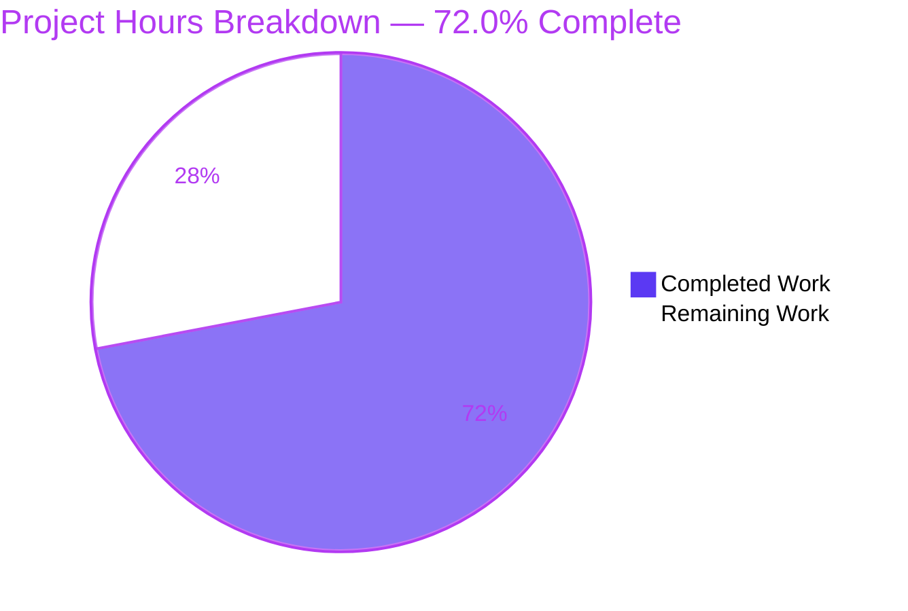
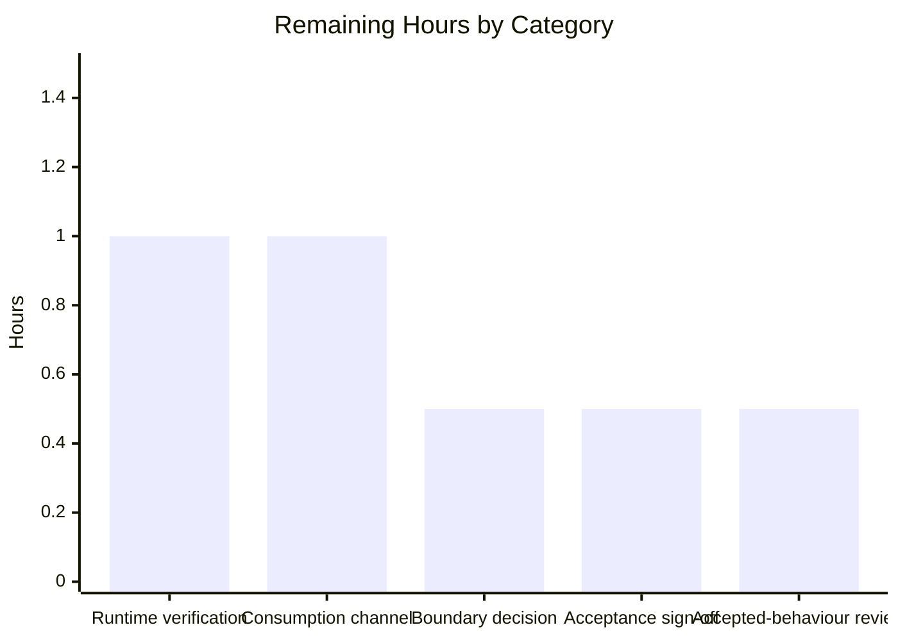

# 1. Executive Summary

## 1.1 Project Overview

This project delivers the smallest runnable artefact that satisfies its request: a zero-dependency Node.js console script that prints the exact string `Welcome to Blitzy` to standard output, with a three-line README stating what it prints and how to run it. It serves developers wanting a quick smoke check and the stakeholder who asked for the greeting. The scope is fully bounded: `index.js` and `README.md` at the repository root, one unconditional statement, no manifest, no lockfile, no dependency, no build step, no configuration, no test suite and no user interface. A generated status report is also tracked under `blitzy/documentation/`. Success is the exact output rather than a feature set.

## 1.2 Completion Status

Completion measures only the scoped work plus its path-to-production activities.



| Metric | Hours |
|--------|-------|
| Total Hours | 12.5 |
| Completed Hours (AI + Manual) | 9.0 |
| Remaining Hours | 3.5 |

**9.0 completed hours ÷ 12.5 total hours = 72.0% complete.** All completed hours are autonomous; no manual engineering time has been spent. Of the 16 requirements in scope, 14 are complete and 2 are partial — the repository boundary, because the tree tracks a generated status report beside the two delivered files, and the runtime recommendation, whose wording is verified while the line it names has never been exercised.

## 1.3 Key Accomplishments

- The exact greeting: 18 bytes, `Welcome to Blitzy` plus one newline, verbatim (`index.js:2`).
- One-command operation from a clean checkout, with no install, build or configuration step (`README.md:3`).
- A repository whose deliverable is exactly two files, one code and one documentation, both at the root.
- Zero dependencies: no manifest, no lockfile, nothing to install or keep in step.
- Deterministic output across 100 sequential runs, 20-way concurrency, 8 argument shapes, 4 stdin conditions and 9 environment shapes.
- Silence beyond the greeting: empty standard error, no help text, no error path, no environment read, no argument parsing.
- A byte-exact acceptance gate, documented and passing: `node index.js | diff - <(printf 'Welcome to Blitzy\n')` reports `GATE_PASS`.
- A run instruction that works verbatim, in a three-line README under its five-line cap.

## 1.4 Critical Unresolved Issues

**5 of the 16 requirements in scope carry an open item; none blocks the running artefact, and three block sign-off.**

| Issue | Impact | Owner | ETA |
|-------|--------|-------|-----|
| The recommended Node.js 24 LTS line has never been exercised, and Node.js 24 has been Maintenance LTS since 2026-10-20 | The recommendation is unconfirmed on the line it names and one LTS cycle behind the current Active LTS | Release engineer | 0.5 day |
| The repository tracks a generated status report besides the two agreed files | A strict reading of "do not create any other file" is not met, and the report ages independently of the code | Maintainer | 0.5 day |
| No consumption channel is defined for a manifest-free script | Consumers have no agreed way to obtain the entry point | Maintainer | 0.5 day |
| Acceptance sign-off against the original request is outstanding | Release waits on the stakeholder's confirmation of the content, the file boundary and where the decision record lives | Requesting stakeholder | 0.5 day |
| An unwritable or closed standard output is silent (exit 0, empty stderr) | A consumer checking only the exit status could read a lost write as success | Product owner | 0.5 day |

## 1.5 Access Issues

| System/Resource | Type of Access | Issue Description | Resolution Status | Owner |
|-----------------|----------------|-------------------|-------------------|-------|
| Node.js 24 LTS runtime | Runtime installation | The recommended line is not installed on this host, and installing a second Node.js release is outside the environment's constraints because the host's default runtime is shared with other work; verification ran on Node.js v22.23.4 | Open | Release engineer |

No other access issues identified: no credential, third-party API, database, port or service is needed, and the program reads no environment variable.

## 1.6 Recommended Next Steps

1. **[High]** Run the byte-exact gate and confirm the greeting, the tracked file inventory and the README wording.
2. **[High]** Run the program on the recommended Node.js line before announcing that recommendation, or revise the recommendation to the current Active LTS line.
3. **[Medium]** Decide and record how consumers obtain a script with no manifest or packaging.
4. **[Medium]** Decide whether the tracked generated status report belongs in the repository, and record the exception or remove the file.
5. **[Low]** Decide whether the designed silence on an unwritable standard output is acceptable for the intended consumers.

# 2. Project Hours Breakdown

## 2.1 Completed Work Detail

| Component | Hours | Description |
|-----------|-------|-------------|
| Console entry point — the greeting on standard output | 1.5 | `index.js` — the single unconditional statement that writes the fixed greeting, in the required two-line form with one one-line JSDoc summary, verified byte-for-byte across every output channel. |
| One-command run from a clean checkout | 1.5 | `index.js` at the repository root, executable as `node index.js` with no install, build or configuration step, verified from a clean copy, a source-archive extract, a fresh clone, the repository root, relative and absolute path forms, stripped and HOME-less environments and a path containing a space. |
| Repository README usage note | 1.0 | `README.md` — the three-line note carrying the run instruction and the runtime recommendation within the five-line cap, with every claim resolved against the code and the runtime documentation it cites. |
| Zero-dependency delivery | 1.0 | The absence of any manifest, lockfile and dependency, established and then confirmed at runtime: the program runs with nothing installed, loads one module and never invokes a package manager. |
| Deterministic single-output execution | 1.5 | Invariance of the output across 100 sequential runs, 20-way concurrency, 8 argument shapes, 4 stdin conditions and 9 environment shapes, together with the measurement of exactly one 18-byte write to standard output. |
| Silence and no added behaviour | 1.0 | Confirmation that nothing beyond the single greeting is emitted or read: empty standard error under every flag, argument, stdin and environment variant, with no help text, error path, environment read or fallback. |
| Content contract, comment form and repository boundary | 1.5 | Byte-exact comparison of both delivered files against the agreed content, the line budgets, the single one-line comment, and repository inventories recording two delivered files beside a tracked generated status report while confirming every excluded artefact is absent. |
| **Total** | **9.0** | |

Section 2.1 plus Section 2.2 equals the 12.5 Total Project Hours in Section 1.2.

## 2.2 Remaining Work Detail

| Category | Hours | Priority |
|----------|-------|----------|
| Runtime verification on the recommended Node.js line — confirm the greeting on Node.js 24 LTS, the line the README names, or revise the recommendation to the current Active LTS line | 1.0 | Medium |
| Consumption channel for the manifest-free entry point — decide and record how a consumer obtains and runs a script that ships with no manifest or packaging | 1.0 | Medium |
| Repository-boundary decision — keep the tracked generated status report and record the exception to the two-file rule, or remove it from the repository | 0.5 | Medium |
| Human acceptance sign-off — confirm the exact file contents, the repository boundary and the README wording against the original request, and acknowledge where the decision record lives | 0.5 | High |
| Accepted-behaviour review — decide whether the designed silence on an unwritable standard output is acceptable for the intended consumers, or raise a change request against the constraint | 0.5 | Low |
| **Total** | **3.5** | |

No item here asks for work the request forbids: none of these adds a manifest, a dependency, a test artefact, a configuration file or any hardening to the program.

## 2.3 Estimation Basis

Completed hours were sized from the behaviour delivered and the verification exercised over it, since the artefacts themselves are five lines in total and their cost lies in the exactness of the content and the breadth of the runtime confirmation. Remaining hours were sized from the five open items in Section 1.4, using straightforward per-task estimates: a runtime verification on a second Node.js release (1.0h), a release decision and its written record on the consumption channel (1.0h), a boundary decision on the tracked generated status report (0.5h), a stakeholder review pass (0.5h) and a product decision on one accepted behaviour (0.5h).

Confidence is **high** on the completed figure: both files are byte-exact to the agreed content and every acceptance check was run first-hand rather than inferred. Confidence is **medium** on the remaining figure, because the tail consists of human decisions whose scope depends on the release channel ultimately chosen.

**Completion = Completed Hours ÷ (Completed Hours + Remaining Hours) × 100 = 9.0 ÷ 12.5 × 100 = 72.0%.**

# 3. Test Results

The project ships with no test framework, and none may be added: the request forbids a test suite, a lockfile, a dependency and any manifest, so the acceptance criterion is the exact content of the two files and their behaviour when run. What follows is the acceptance battery executed against the delivered revision — a syntax gate, the documented byte-exact gate, and 88 checks grouped by the area of behaviour each one exercises. Every count below was observed in a run against the delivered files on Node.js v22.23.4.

| Area / Category | Framework | Tests | Passed | Failed | Coverage | What This Proves |
|-----------------|-----------|-------|--------|--------|----------|------------------|
| Greeting fidelity | Node.js CLI, byte comparison | 14 | 14 | 0 | Not measured | Standard output is exactly `Welcome to Blitzy` plus one newline — 18 bytes, verbatim — and arrives complete through a pipe, a regular file, `/dev/null`, a FIFO, a terminal, a slow reader and a consumer that closes after one byte, with no escape sequence or non-ASCII byte. |
| Clean-checkout invocation | Node.js CLI, git | 11 | 11 | 0 | Not measured | One command runs the program from a source-archive extract, a fresh clone, a two-file copy, a stripped environment with and without `PATH`, a foreign working directory, a symlink, a path containing a space, a read-only directory and `sh -c`, with nothing installed. |
| Tree confinement | Node.js CLI, git, module trace | 6 | 6 | 0 | Not measured | Running the program creates, writes and reads nothing: the tree is unchanged and the working tree clean afterwards, a directory holding only the entry point gains no file, exactly one code file is tracked, and exactly one module is loaded. |
| Determinism | Node.js CLI | 9 | 9 | 0 | Not measured | Output is identical across 100 sequential runs, 20-way concurrency, 8 argument shapes, a 10,000-character argument, piped, 1 MB, `/dev/null` and closed stdin, and 9 environment shapes including colour-forcing and locale-changing values. |
| Silence and no added behaviour | Node.js CLI | 6 | 6 | 0 | Not measured | Nothing beyond the single greeting is emitted: empty standard error under `--help`, no help, usage or version text, no error or warning wording, no environment read and no argument parsing. |
| Dependency freedom | Node.js CLI, module trace | 10 | 10 | 0 | Not measured | No manifest, lockfile, `node_modules`, `.npmrc` or `.nvmrc` exists, the source contains no `require` or `import`, exactly one module loads at runtime, and the program runs with a deliberately bogus `NODE_PATH`. |
| Content contract | `cmp`, `wc`, `grep`, `od` | 13 | 13 | 0 | Not measured | Both files match the agreed content byte-for-byte (88 bytes over two lines, 111 over three), within their line budgets, with one single-line comment, no tag block, no forbidden construct and a single trailing newline each. |
| Repository inventory | `find`, `git ls-files` | 19 | 19 | 0 | Not measured | Every excluded artefact and construct is absent — 17 probed paths including licence, changelog, contributing, container, tooling and ignore files, plus no CI configuration and no test file in the tracked set. |
| **Total** | | **88** | **88** | **0** | | |

**Gates.** Both gates were run directly and both pass: `node --check index.js` exits 0 with no diagnostics, and the byte-exact gate `node index.js | diff - <(printf 'Welcome to Blitzy\n') && echo GATE_PASS` produces no difference and reports `GATE_PASS`. Fifty sequential runs collapse to a single distinct line, the greeting measures 18 bytes, and `git status --porcelain` is empty afterwards. The two commands a reader may reach for first fail by design: `npm start` exits 254 because no manifest exists, and `./index.js` exits 126 because the entry point carries no shebang line and is not executable.

**Coverage is not measured anywhere in this project.** No instrumentation, coverage or test-framework tooling exists in the tree, and adding it is forbidden by the request, so no coverage percentage can be stated. The byte-exact gate is the durable acceptance check and the only regression safety net the repository carries.

### Not Covered

These are delivered or present but not exercised by any test, and a human should confirm them before release:

- **The recommended runtime line.** The README names Node.js 24 LTS as a recommendation, and the greeting was exercised only on the Node.js v22 line available here. Node.js 24 has been Maintenance LTS since 2026-10-20, with Node.js 26 the current Active LTS. Nothing in the program is version-sensitive — it is a single call to a long-standing built-in — but the recommendation is unconfirmed on the line it names. Confirm the 18-byte output, empty standard error and exit status 0 on that release before announcing it.
- **Any release older than Node.js v22.** No lower bound was declared or exercised, so the oldest supported line is unverified.
- **Direct execution of the file.** `./index.js` is not a supported invocation: the entry point is a non-executable regular file with no shebang line, which the request requires. The documented `node index.js` form is the one that works; a human should ensure nothing downstream assumes otherwise.
- **An unusual standard-output sink.** A datagram-socket standard output delivers no bytes; a one-line control program behaves identically, so this is runtime behaviour rather than a property of the delivered code, but it is unverified for this program.
- **The designed silence on a failing sink.** A full or closed standard output exits 0 with empty standard error by design; only that outcome was observed, and whether it is acceptable to the intended consumers is a decision rather than a test.
- **The tracked generated status report.** The program never reads it and no check exercises it, so its accuracy ages independently of the code and nothing detects drift between the two.

# 4. Runtime Validation & UI Verification

The delivered program has no user interface, no HTTP surface, no network call and no component boundary, so there is no screen to drive, no form to fill and no endpoint to call. Its entire runtime surface is one command, two output streams, an exit status and the immutability of the tree; each of those was exercised. The statuses below describe what was actually run, on Node.js v22.23.4.

- ✅ **Start-up and invocation** — `node index.js` from the repository root, from a two-file copy, from a source-archive extract with no `.git`, from a fresh clone, by relative and absolute path, under `sh -c`, via a symlinked entry point, in a stripped environment and with the network namespace removed: exit status 0 every time.
- ✅ **Greeting output** — 18 bytes, `Welcome to Blitzy` followed by one newline, byte-identical to the reference through a pipe, a regular file, `/dev/null`, a FIFO, a terminal, a slow reader and a consumer that closes after one byte.
- ✅ **Determinism under repetition and concurrency** — 100 sequential runs and 20-way parallel runs each produced a single distinct line with no partial or interleaved output.
- ✅ **Argument, stdin and environment invariance** — flags including `--help`, `-h` and `--version`, a 10,000-character argument, empty, closed, piped and one-megabyte stdin, and nine environment shapes including stripped, hostile and colour-forcing values: byte-identical output, empty standard error, exit status 0.
- ✅ **Runtime confinement** — the repository tree, a two-file copy and a directory holding only the entry point are unchanged after every run, exactly one module is loaded, no file or socket is opened, no process outlives the invocation, and the program runs from a read-only directory.
- ✅ **No external integrations** — the program opens no socket, reads no file, holds no credential and reads no environment variable, so there is no integration to exercise and none was attempted.
- ⚠ **Recommended runtime** — the greeting was exercised on Node.js v22.23.4 only; the Node.js 24 LTS line the README recommends was never run, and that line is now in Maintenance LTS.
- ⚠ **Unwritable or closed standard output** — the program exits 0 with empty standard error, so the failure is not surfaced; this is the designed outcome of the request's no-error-handling constraint.
- ⚠ **Repository inventory** — the program itself touches only its own source, but the repository tracks a generated status report besides the two delivered files, and nothing exercises that file.
- ❌ **Failing flows** — none: every flow exercised reached its expected outcome.

**Never exercised at runtime:** the recommended Node.js 24 LTS line and any release below v22; direct execution of the file, which is not a supported invocation because the entry point carries no shebang line and is not executable; and an unusual datagram-socket standard output. No browser, HTTP, database or user-interface validation was performed or applies, because the deliverable has no surface of that kind.

# 5. Compliance & Quality Review

## 5.1 Compliance Matrix

Each deliverable is shown in the state it stands in now, against the quality and compliance expectations this change was held to: the request's own constraints, the content and boundary the change was planned to deliver, and the standard expectations of a zero-dependency Node.js console script.

| # | Deliverable | Status | Evidence |
|---|-------------|--------|----------|
| 1 | Greeting written to standard output exactly, unformatted (FR1) | ✅ Complete | `index.js:2`; 18 bytes, digest-matched, through seven sink kinds |
| 2 | Runnable from a clean checkout with one command, no install, build or configuration (FR2) | ✅ Complete | `README.md:3`; 11 invocation checks from copies, archives, clones and stripped environments |
| 3 | Run instruction carried in the README within the stated line cap (FR3) | ✅ Complete | `README.md` 3 lines against a cap of 5; the instruction works verbatim |
| 4 | Implementation confined to one code file at the root (FR4) | ✅ Complete | `index.js` is the tree's only code file; the command needs no path prefix |
| 5 | Two-line lowest-token form, semicolon, double-quoted literal, one trailing newline (NFR1) | ✅ Complete | 2 lines / 88 bytes, byte-exact to the agreed content |
| 6 | Zero runtime and development dependencies (NFR2) | ✅ Complete | No manifest, lockfile or dependency; one module loads at runtime |
| 7 | Deterministic single-path execution with one stdout write (NFR3) | ✅ Complete | 9 invariance checks; exactly one 18-byte write measured |
| 8 | Nothing beyond the request — no error handling, logging, configuration or hardening (NFR4) | ✅ Complete | Zero forbidden constructs; empty standard error in every run |
| 9 | Content contract and comment form | ✅ Complete | Both files byte-exact; one single-line summary comment; no tag block |
| 10 | Required absences — every excluded artefact and construct is missing | ✅ Complete | 19 probed paths and constructs absent; no test artefact, manifest or tooling |
| 11 | Runtime recommendation named as a recommendation, with the behaviour holding on the line it names | ⚠️ Partial | `README.md:3` wording verified and no version floor declared; the recommended line was never exercised, and it is now Maintenance LTS |
| 12 | Two-file repository boundary and implementation order | ⚠️ Partial | The two delivering commits touch only the planned files and the entry point landed before the documentation, but the tree tracks a generated status report as a third path |

## 5.2 AAP & Rule Divergences and Gaps

Nine departures were identified. Each is stated in terms of the delivered codebase, with the evidence a reader can open. Four are sanctioned — three by the request's own constraints and one by the precedence that puts the plan above the user Rules — one follows a more specific content specification, one is a boundary the delivered tree does not meet, one is constrained by the environment, one is a labelling difference with no effect on the delivered bytes, and one is a designed behaviour accepted rather than changed.

| # | What the AAP/Rule Required | What Was Delivered Instead | Why It Diverged | Impact | Remediation |
|---|----------------------------|----------------------------|-----------------|--------|-------------|
| 1 | Both files described as creations in a workspace holding no files, with nothing updated (AAP 0.6.2, 0.8.1) | `README.md` already existed as a two-line placeholder and was rewritten in place (`21dc284`), so it arrives as a modification; `index.js` was created (`886de65`) | The plan's premise about the starting state did not hold: the file was already tracked | None to the delivered content, which is exactly the agreed three lines; a reader reverting or re-documenting the change set must not treat the file as newly created | None required — read `README.md` as a rewrite of the placeholder commit `e070a69` introduced |
| 2 | The documentation is "one `#` heading and one sentence" (AAP 0.11.1) | `README.md:3` carries two sentences — what the program prints, then how to run it | AAP 0.5.1 fixes that line verbatim and is the acceptance criterion, so the specific content specification governs the general writing guideline | None; the second sentence is the run instruction, which has nowhere else to live | None required |
| 3 | A delivered change is expected to carry a lint step, a Markdown linter and a test framework | Validation used `node --check index.js` for syntax, structural checks for the Markdown and a harness kept outside the checkout for behaviour; no test artefact is committed | **Sanctioned** — the request forbids a test suite, a lockfile, any dependency and any manifest | The repository carries no automated regression guard; the byte-exact gate is the only check | Keep the byte-exact gate as the release precondition; revisit only if the no-tooling constraint is lifted |
| 4 | Error handling throughout, appropriate logging points and a test coverage target | No error handling, no logging and no coverage target | **Sanctioned** — the request forbids all three | None on correctness: the delivered program is exactly what was asked for | None — the absences are the requirement |
| 5 | Rule 1 (Explainability) requires the decision record delivered as a Markdown table in the repository | Delivered as a maintained decision record outside the repository; `index.js:1` states behaviour rather than rationale | **Sanctioned by precedence** — the request's "do not create any other file" and the five-line README cap close the file list, and the AAP outranks the user Rules | A reader of the checkout alone cannot see why decisions were taken | Accept the override, or lift the no-other-file constraint if an in-repository log is required (0.5h, inside the sign-off) |
| 6 | No file other than the two above created, modified or deleted (AAP 0.7.2) | The repository tracks a third path: `blitzy/documentation/Project Guide - cf36ab07-42cd-4100-bbd6-228611d75db0.md`, 407 lines, added by `b4d3ea7`; the two delivering commits themselves touch only the planned files | The file is the project's published status report and was left in place rather than deleted, since removing it would remove the account of the work that produced it | A strict reading of the request's file boundary is not met, and the report records the project as it stood when written, so its figures age independently of the code | Decide whether it belongs in the repository: record the exception or remove the file (0.5h) |
| 7 | The README recommends Node.js 24 LTS, and the behaviour it claims should hold on the line it names (AAP 0.2.1, 0.3.1) | Delivered as specified and verified on Node.js v22.23.4 only; Node.js 24 has since become Maintenance LTS, with Node.js 26 the Active LTS since 2026-10-28 | The recommendation text is fixed byte-for-byte by AAP 0.5.1, and no second Node.js release may be installed here because the host's default runtime is shared | The recommendation is unconfirmed on the line it names and one LTS cycle behind; nothing in the program is version-sensitive | Run the program on Node.js 24 LTS and record the result, or revise the recommendation to the Active LTS line (1.0h) |
| 8 | Error handling, exit-code handling, logging and hardening are all forbidden | A full or closed standard output exits 0 with nothing on standard error | The prohibition is the requirement itself, so nothing can surface a failed write | Low: a consumer checking only the exit status could read a lost greeting as success | Decide whether this is acceptable for the intended consumers (0.5h); if not, raise a change request against the constraint rather than editing the program |
| 9 | No tooling and no manifest, so no ignore file may be added | Two empty, untracked artefact directories (`blitzy/screenshots/`, `blitzy/screen_recordings/`) remain in the working tree with no `.gitignore` covering them | **Sanctioned** — the run instructions forbid committing these directories and forbid adding an ignore file | None: git cannot commit an empty directory and the working tree reports clean | None required |

**Divergence 1 — the README is a rewrite, not a creation.** The plan describes both files as creations in a repository holding no files and states that nothing is updated. In fact `README.md` was already tracked: commit `e070a69` added it with the two-line placeholder `# 5th-project-511d0ab5` / `Created by Blitzy`, and commit `21dc284` replaced those lines with the three agreed ones, so the change arrives as `M README.md`. The cause is that the plan's premise about the starting state did not hold. The delivered bytes are identical to the agreed content, so nothing is missing; anyone reverting or re-documenting this change should treat `README.md` as a rewrite of the placeholder, not as a file the change created.

**Divergence 3 — permitted checks stood in for the expected tooling.** The standard process for a delivered change expects a lint step, a Markdown linter and a test framework. None was used, because the request forbids a test suite, a lockfile, any dependency and any manifest, so adding one would itself have been the violation. Syntax was gated with `node --check index.js`, which parses without executing; the Markdown was checked structurally for line count, encoding and balanced delimiters; and behaviour was exercised from a harness kept outside the checkout. Its consequence is what a reviewer should weigh: no automated regression guard exists, so the byte-exact gate is the only check and it belongs in the release procedure.

**Divergence 5 — the decision record lives outside the repository.** Rule 1 asks for a decision log delivered as a Markdown table, covering alternatives, rationale and risks, with an explicit entry for every deviation. The request simultaneously forbids creating any file beyond the two, and the README is capped below five lines, so no location inside the checkout exists for it. The AAP outranks the Rules, so the substance is delivered as a maintained record beside the work and `index.js:1` stays a statement of behaviour. The consequence a maintainer should know: someone reading only the checkout cannot see why the two-line form, the manifest-free layout or the README-first-run instruction were chosen.

**Divergence 6 — a third tracked path reaches the repository.** `git ls-files` returns three paths, not two: `index.js`, `README.md` and `blitzy/documentation/Project Guide - cf36ab07-42cd-4100-bbd6-228611d75db0.md`, a 407-line generated status report added by `b4d3ea7`. The two commits that deliver the product (`886de65`, `21dc284`) touch only the agreed files, so the change itself respects the boundary; the report arrives as the account of the delivery and was left in place rather than deleted. On a strict reading of "do not create any other file" the delivered tree does not meet the boundary. The report is also a snapshot: it records the project as it stood when it was written, so a reader who takes its figures for current will be working from a stale number, and nothing detects that drift. Decide whether it belongs and act in one direction or the other.

**Divergence 7 — the recommended runtime line is unverified and now a cycle behind.** `README.md:3` tells a reader that Node.js 24 LTS is recommended. The program was delivered exactly as agreed and verified on Node.js v22.23.4, the line this host provides; the recommended line was never run, because no second Node.js release may be installed here and the host's default runtime is shared with other work. No version floor was ever set — no `engines` field, version file or version matrix exists — so nothing in the delivered behaviour is version-sensitive. The release schedule has also moved: Node.js 24 has been Maintenance LTS since 2026-10-20 and is supported to 2028-04-30, while Node.js 26 is the Active LTS line. The remedy belongs to release: run the program on the recommended line, confirm the 18-byte greeting with empty standard error and exit status 0, or point the recommendation at the current Active LTS line.

**Divergence 8 — an unwritable standard output is silent.** When standard output is full or closed, the program exits 0 with nothing on standard error: the single 18-byte write is issued and its failure is not surfaced. This is accepted rather than changed, because error handling, exit-code handling, logging and hardening are all forbidden by the request — only a change to that constraint could settle it. The impact is narrow but real: a consumer checking only the exit status would read a lost greeting as success. Before release, decide whether that is acceptable for the intended consumers; if not, raise a change request against the constraint rather than editing the program.

# 6. Risk Assessment

Risks below are forward-looking: what could still go wrong once this change is in use.

| Risk | Category | Severity | Probability | Mitigation | Status |
|------|----------|----------|-------------|------------|--------|
| No automated regression guard protects the greeting — the repository holds no test, manifest or CI, by requirement | Technical | Medium | Medium | Run the byte-exact gate as a release precondition, and re-run it after any edit to `index.js` or `README.md` | Open |
| An unwritable or closed standard output exits 0 with empty standard error, so a lost write looks like success | Operational | Medium | Medium | Verify the greeting from captured output rather than the exit status; decide whether the designed silence is acceptable | Accepted by design |
| The README recommends Node.js 24 LTS, a line now in Maintenance LTS, and that line was never exercised | Technical | Low | Medium | Confirm the greeting on the recommended line before announcing it, or revise the recommendation to the Active LTS line | Open |
| The repository tracks a generated status report beyond the agreed two files, and it ages independently of the code | Operational | Low | Medium | Decide whether it belongs and either record the exception or remove it; treat the code and the acceptance gate as the source of truth for behaviour | Open |
| The documented command is working-directory relative, so it fails outside the directory holding the file | Operational | Low | Low | State the directory requirement when handing over; an absolute path to the entry point works from anywhere | Open |
| The greeting is duplicated — the literal in `index.js:2` and its quotation in `README.md:3` must stay in step | Technical | Low | Medium | Edit both together and re-run the byte-exact gate; no automated check keeps them aligned | Open |
| Nothing packages or distributes the entry point, since it ships with no manifest | Integration | Medium | Medium | Decide how consumers obtain it — clone, source archive or a copy of the two files — and record the step | Open |
| Build-host credentials are visible to tooling running on the same host | Security | Low | Low | The program reads no environment variable and emits only the fixed greeting, so no exposure path runs through it; keep release tooling on an isolated host | Informational |

The security posture is unusually narrow and worth stating plainly: there is no input surface, no credential, no socket, no file access, no dependency chain and no injection vector anywhere in the deliverable. The only sink is a compile-time constant literal written to standard output, and the only data that leaves the process is the greeting. Integration risk is confined to the packaging question above, because the program calls no external service and exchanges no data.

# 7. Visual Project Status

The two charts below carry the same hours as Sections 1.2 and 2.2: 9.0 completed, 3.5 remaining, 12.5 total, and 72.0% complete.




| Visual | Value | Notes |
|--------|-------|-------|
| Completed Work | 9.0 h | Dark Blue (#5B39F3) — delivered and verified work, per Section 2.1 |
| Remaining Work | 3.5 h | White (#FFFFFF) — the five open items, per Section 2.2 |
| Completion | 72.0% | 9.0 ÷ 12.5 |
| Remaining by priority | High 0.5 h, Medium 2.5 h, Low 0.5 h | Sign-off is the only High-priority item |

# 8. Summary & Recommendations

The change is delivered and verified: **72.0% complete (9.0 of 12.5 hours)**. Both files exist exactly as agreed, at the repository root, and both were compared byte-for-byte against the content the change was planned to deliver. The program prints `Welcome to Blitzy` followed by one runtime-supplied newline, and that 18-byte output was confirmed on every channel it can reach — a pipe, a regular file, a terminal, a FIFO, a slow reader and an early-closing consumer — with empty standard error and exit status 0 every time. Of the 16 requirements in scope, 14 are complete and two are partial: the repository boundary, because a generated status report is tracked beside the two delivered files, and the runtime recommendation, whose wording is verified while the line it names has never been executed.

What the reader can rely on now is a small, exact and thoroughly exercised contract. The program runs from a clean checkout with one command and no install, build or configuration step; it declares no dependency, loads one module and needs nothing installed; it produces identical output across 100 sequential runs, 20-way concurrency, 8 argument shapes, 4 stdin conditions and 9 environment shapes; it emits nothing but the greeting, reading no argument, no stdin and no environment variable; and it leaves the tree byte-identical after every run. The deliverable is two files, one code and one documentation, and every artefact the request excludes — manifest, lockfile, dependency, test suite, workflow, licence, changelog, container, tooling configuration — is absent. 88 acceptance checks were executed against the delivered revision and all 88 pass, and both gates pass: the syntax gate, and the byte-exact gate `node index.js | diff - <(printf 'Welcome to Blitzy\n')`, which reports `GATE_PASS`.

The remaining 3.5 hours are decisions rather than construction. The one genuine verification gap is the recommended runtime: the README names Node.js 24 LTS, that line has never been exercised, and it has meanwhile moved to Maintenance LTS, so it should be confirmed or replaced before the recommendation is announced (1.0h). The rest is judgement a human owns — how consumers obtain a script that ships with no manifest or packaging (1.0h), whether the tracked generated status report belongs in the repository (0.5h), the acceptance sign-off against the original request (0.5h), and a decision on whether the designed silence of an unwritable standard output is acceptable for the intended consumers (0.5h).

The critical path to production is therefore short and mostly procedural: run the byte-exact gate, confirm the greeting on the recommended runtime, decide the consumption channel, settle the report's place in the repository, and sign off. None of that requires code. Nine departures from the plan or the governing constraints are recorded in Section 5.2, and none blocks the running artefact: four are sanctioned by the request's constraints or by the plan's precedence over the rules, one follows a more specific content specification, one is the tracked status report, one is the environment's lack of the recommended runtime, one is a labelling difference with no effect on the delivered bytes, and one is a designed behaviour accepted rather than changed.

**Production readiness: ready to ship, with three preconditions.** The running artefact is byte-exactly what was asked for, behaves identically under every sink, argument, stdin, environment, working-directory and concurrency variation tested, holds no file and no socket, and needs nothing installed. The preconditions are that the byte-exact gate is run as the release check — it is the only regression safety net the repository carries, since no test artefact may exist — that the recommended runtime is confirmed before it is announced, and that the tracked status report's place in the repository is decided. The absent build, lint, type-check and test-suite gates are the request's own requirement, not a readiness gap.

| Metric | Value |
|--------|-------|
| Completion (AAP-scoped) | 72.0% — 9.0 of 12.5 hours |
| Requirements in scope | 16 — 14 complete, 2 partial, 0 not started |
| Acceptance checks run | 88 passed, 0 failed |
| Open items | 5 of 16 requirements; none blocks the running artefact, three block sign-off |
| Recorded divergences | 9 — four sanctioned, none blocking the artefact |
| Remaining effort | 3.5 hours |

# 9. Development Guide

This section covers everything needed to build, run and troubleshoot the deliverable. Every command below was executed from the repository root and is copy-pasteable as written.

### System Prerequisites

- **Node.js with npm.** Verified on Node.js v22.23.4 with npm 11.21.0. The README recommends Node.js 24 LTS as a recommendation only; no version floor is declared and no version file exists, because the program is a single call to a long-standing built-in. Node.js 24 remains supported to 2028-04-30, and Node.js 26 is the current Active LTS line.
- **Git**, to obtain or inspect the checkout.
- Nothing else. There is no database, broker, cache, container, service, credential or environment variable, and no hardware requirement beyond a shell.

### Environment Setup and Dependency Installation

There is none, and that is deliberate.

```bash
git clone <repository-url>
cd <repository>
```

The deliverable is two files — `index.js` and `README.md`. A generated status report is also tracked under `blitzy/documentation/`; it is documentation and nothing reads it at runtime. Do not run an install step, do not create a `package.json`, and do not add a lockfile, a dependency, a test framework or an ignore file: the request permits only the two deliverable files to exist, so adding any of them is a defect rather than a convenience.

### Application Startup

```bash
node index.js
```

Expected output on standard output, exactly:

```text
Welcome to Blitzy
```

Standard error is empty and the exit status is 0. The runtime supplies the single trailing newline; the program neither adds nor suppresses one. There is no service to start, no port to bind and no process that outlives the invocation.

### Verification Steps

```bash
# Syntax gate — parses without executing. Expected: no output, exit status 0.
node --check index.js

# Byte-exact acceptance gate. Expected: no diff output, then GATE_PASS.
node index.js | diff - <(printf 'Welcome to Blitzy\n') && echo GATE_PASS

# Inspect the exact bytes. Expected: 18 bytes ending in \n.
node index.js | od -c

# Confirm the shape of the repository. Expected: README.md, index.js and the tracked status report; an empty porcelain.
git ls-files
git status --porcelain
```

The expected byte sequence is `57 65 6c 63 6f 6d 65 20 74 6f 20 42 6c 69 74 7a 79 0a` — capital `W` and capital `B`, one space between each pair of words, no trailing punctuation, and one final newline.

### Example Usage

```bash
# Run it and capture both streams and the status.
node index.js > out.txt 2> err.txt; echo "exit=$?"

# Compare the captured bytes with the expected greeting.
cmp out.txt <(printf 'Welcome to Blitzy\n') && echo IDENTICAL

# Confirm determinism across repeated runs — one distinct line expected.
for i in $(seq 1 50); do node index.js; done | sort -u

# Confirm the output does not vary with arguments, stdin or environment.
node index.js --help | od -c
printf 'anything\n' | node index.js | od -c
env -i PATH=/usr/bin:/bin node index.js
```

All four produce the same 18 bytes with empty standard error and exit status 0. Delete `out.txt` and `err.txt` afterwards — they are your shell's redirection targets, not files the program creates.

### Troubleshooting

| Symptom | Cause | Resolution |
|---------|-------|------------|
| `npm start` fails with `npm error code ENOENT` and exit status 254 | The repository has no `package.json`, by design, so npm has no script to run | Run `node index.js` instead — that is the documented command |
| `./index.js` fails with `Permission denied` and exit status 126 | The entry point is a non-executable regular file and carries no shebang line, which the request requires | Run `node index.js`; do not add a shebang or make the file executable |
| `node index.js` fails with `Cannot find module '/somewhere/index.js'` and `MODULE_NOT_FOUND` | The documented command is relative and was run from a directory that does not hold `index.js` | Run it from the checkout root, or use an absolute path: `node "$(git rev-parse --show-toplevel)/index.js"` |
| The gate reports a difference | `index.js:2` and `README.md:3` are the two places the greeting appears; one of them was edited without the other, or the trailing newline changed | Restore the exact statement in `index.js` and the exact sentence in `README.md` (`git checkout -- .` restores both), then re-run the gate |
| The greeting is lost when piped somewhere | A full or closed output sink exits 0 with nothing on standard error, because error handling is forbidden | Check the sink, and verify the output by capturing it rather than by relying on the exit status |
| Nothing appears at all | The program was run without the runtime, or the file was replaced | Confirm the entry point exists at the repository root and run `node index.js` |

# 10. Appendices

## A. Command Reference

All commands run from the repository root.

| Command | Purpose | Expected Result |
|---------|---------|-----------------|
| `node index.js` | Run the program | `Welcome to Blitzy` on standard output, empty standard error, exit status 0 |
| `node --check index.js` | Syntax gate, parses without executing | No output, exit status 0 |
| `node index.js \| diff - <(printf 'Welcome to Blitzy\n') && echo GATE_PASS` | Byte-exact acceptance gate | No diff output, then `GATE_PASS` |
| `node index.js \| od -c` | Inspect the exact output bytes | 18 bytes ending in `\n` |
| `node index.js \| wc -c` | Output length | `18` |
| `node index.js \| wc -l` | Line count | `1` |
| `node index.js > out.txt 2> err.txt; echo $?` | Capture both streams and the status | `out.txt` holds the greeting, `err.txt` is empty, status `0` |
| `node index.js --help` | Confirm no help or usage text is emitted | The greeting only, empty standard error |
| `npm start` | Confirm the manifest-free layout | Exit status `254` with `ENOENT` — by design; use `node index.js` |
| `./index.js` | Confirm the entry point is not directly executable | Exit status `126`, `Permission denied` — by design |
| `git ls-files` | List the tracked files | `README.md`, `index.js` and the tracked status report under `blitzy/documentation/` |
| `git status --porcelain` | Confirm the working tree is clean | No output |

## C. Key File Locations

| Path | Role |
|------|------|
| `index.js` | The whole program: a one-line JSDoc summary and the single statement writing the greeting. The only code file, and the file the run command names. |
| `README.md` | The three-line usage note: heading, blank line, and the sentence carrying what the program prints and the command that runs it. |
| `blitzy/documentation/Project Guide - cf36ab07-42cd-4100-bbd6-228611d75db0.md` | A generated status report tracked beside the deliverable. No program code reads it, and it is not part of the two-file contract; it is the third tracked path Section 5.2 asks a maintainer to rule on. |

`index.js` and `README.md` sit at the repository root. The status report is the only other tracked path, and `blitzy/screenshots/` and `blitzy/screen_recordings/` are empty untracked directories that no commit may include.

## D. Technology Versions

| Component | Version | Notes |
|-----------|---------|-------|
| Node.js | v22.23.4 (verified) | The greeting was produced byte-exactly on this line. No version floor is declared or enforced by the code; the README recommends Node.js 24 LTS, which is supported to 2028-04-30, and Node.js 26 is the current Active LTS line |
| npm | 11.21.0 | Present for tooling only; the run needs no package manager and the repository has no manifest |
| Git | System install | Used to obtain and inspect the checkout; no LFS-tracked file exists |
| Dependencies | None | No manifest, no lockfile and no package is declared, required or created |

## F. Developer Tools Guide

The toolchain is deliberately minimal, because the request excludes build, lint, format and test tooling.

| Tool | Role Here |
|------|-----------|
| `node` | Runs the program, parses it with `--check`, and can enforce file-system and child-process denial with `--permission` |
| `git` | Obtains the checkout, shows the change set, and reports whether the tree is dirty |
| `diff` and `printf` | Together with the program's output, form the byte-exact acceptance gate |
| `od`, `wc`, `cmp`, `file` | Inspect output length, exact bytes and encoding |
| `script` | Captures the program's output on a pseudo-terminal, where the terminal's own line discipline adds a carriage return that is not the program's |
| `mmdc` | Renders the Mermaid diagrams in this guide; it has no bearing on the deliverable |

## G. Glossary

| Term | Meaning |
|------|---------|
| Acceptance gate | The byte-exact check comparing the program's standard output with the expected greeting. The only durable regression check this repository carries. |
| AAP-scoped completion | The percentage of the work this change was scoped to deliver, plus the path-to-production activities that follow from it, that is complete. |
| Byte-exact | Identical down to the individual bytes and the trailing newline, not merely equal after trimming. |
| Console entry point | The single executable file, `index.js`, which the run command names and which holds the program's entire logic. |
| Hostile sink | An output destination that cannot accept the write — a full disk or a closed descriptor. The program's behaviour there is silent success, as the request requires. |
| Manifest-free | Having no `package.json`, and therefore no npm scripts, no declared dependencies and no lockfile with which to reproduce an install. |
| Path-to-production | Activities needed to release the delivered change, such as confirming the recommended runtime and signing off the content, as distinct from building it. |
| Standard output | File descriptor 1, the stream the greeting is written to, as distinct from standard error, which stays empty. |
